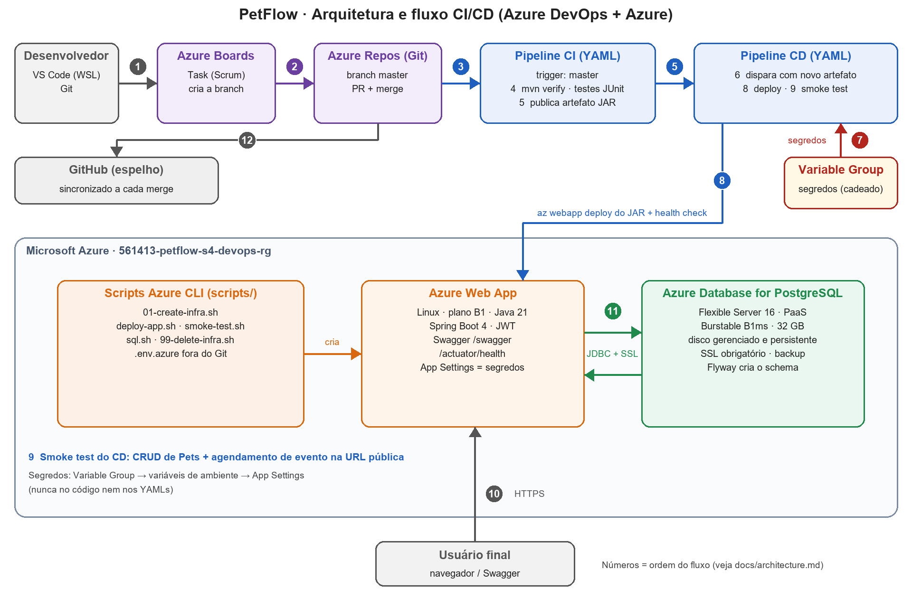

# PetFlow: CI/CD no Azure DevOps (Sprint 4, DevOps Tools & Cloud Computing)

API REST de saúde preventiva pet com gamificação, entregue por pipelines CI/CD do Azure DevOps em um Azure Web App, com banco PostgreSQL gerenciado na nuvem (Azure Database for PostgreSQL).

| Item | Link |
|---|---|
| Projeto Azure DevOps | `<preencher: https://dev.azure.com/...>` |
| Repositório GitHub (espelho) | `<preencher: https://github.com/lgaxd/petflow-devops-sprint4>` |
| Vídeo no YouTube | `<preencher>` |
| Aplicação (Swagger) | `https://561413-petflow-s4-api.azurewebsites.net/swagger` |

| Integrante | RM | Turma |
|---|---:|---|
| Lucas Grillo Alcântara | 561413 | 2TDSPX |
| Pietro Ferreira Gomes Abrahamian | 561469 | 2TDSPX |
| Pedro Peres Benitez | 561792 | 2TDSPX |
| Lucca Ramos Mussumecci | 562027 | 2TDSPX |

## 1. Descrição da solução

O **PetFlow** gamifica o cuidado com o pet. O tutor cadastra seus pets, registra eventos de saúde (vacinas, consultas, vermifugação) e ganha pontos a cada evento realizado. Os pontos viram cupons de desconto em clínicas parceiras. O perfil ADMIN mantém clínicas, planos, cupons e tutores.

A aplicação é uma API REST (Swagger em `/swagger`) com autenticação JWT. Esta entrega mostra o **ciclo de vida da API**: cada merge na `master` é compilado, testado, empacotado e implantado na nuvem sem passo manual.

**Stack**

| Camada | Tecnologia |
|---|---|
| Aplicação | Java 21, Spring Boot 4, Spring Data JPA, Spring Security (JWT), Flyway, springdoc/Swagger |
| Banco | Azure Database for PostgreSQL Flexible Server 16 (PaaS) |
| Hospedagem | Azure App Service Linux (B1, Java SE 21) |
| Infraestrutura | Azure CLI (`scripts/`) |
| CI/CD | Azure Boards, Azure Repos, Azure Pipelines (YAML), Variable Group |
| Testes | JUnit 5, Mockito, MockMvc, JaCoCo (sem banco no CI) |

## 2. Arquitetura e fluxo CI/CD



As 12 etapas numeradas estão descritas em [docs/architecture.md](docs/architecture.md).

## 3. Banco de dados em nuvem

**Azure Database for PostgreSQL Flexible Server 16** (opção "PostgreSQL" do enunciado, PaaS): Burstable B1ms, 32 GB de armazenamento gerenciado e persistente, SSL obrigatório e backup automático. Os dados sobrevivem a reinícios do servidor e a novos deploys. O usuário da aplicação (`DB_USERNAME`, padrão `petflow_user`) é criado pelo script de infra e não é o administrador. O **Flyway** (`src/main/resources/db/migration`, V1 e V2) cria o schema e os dados de demonstração na primeira inicialização da API.

**Por que PostgreSQL e não Oracle:** esta cópia da API foi portada de Oracle para PostgreSQL para ter persistência real e simples na Azure. O DDL foi adaptado e as regras de pontos e resgate, que viviam no package PL/SQL `PKG_PETFLOW_GAMIFICATION`, foram para Java (`RewardPointService`), com os mesmos bloqueios `SELECT ... FOR UPDATE`, as mesmas validações e as mesmas exceções de negócio. O repositório da disciplina de Java continua usando Oracle.

A prova do CRUD no banco usa [database/crud-verification.sql](database/crud-verification.sql), executado com `scripts/sql.sh` (usa o `psql`).

## 4. Projeto no Azure DevOps

| Campo | Valor |
|---|---|
| Project Name | `PetFlow` |
| Description | Projeto para entrega da Sprint 4 do professor João Carlos Menk. Integrantes: 561413 - Lucas Grillo Alcântara - 2TDSPX; 561469 - Pietro Ferreira Gomes Abrahamian - 2TDSPX; 561792 - Pedro Peres Benitez - 2TDSPX; 562027 - Lucca Ramos Mussumecci - 2TDSPX |
| Visibility | Private |
| Version control | Git (Azure Repos, branch `master`) |
| Work item process | Scrum |
| Acesso do professor | `pf0841@fiap.com.br`, access level **Basic** |

Passo a passo completo em [docs/azure-devops.md](docs/azure-devops.md).

## 5. Pipelines CI/CD (YAML)

| Pipeline | Arquivo | Gatilho | O que faz |
|---|---|---|---|
| `petflow-ci` | [pipelines/ci.yml](pipelines/ci.yml) | push/merge na `master` | `mvn clean verify` (build + testes JUnit), publica resultados e cobertura, publica o artefato **drop** com `petflow-api.jar` |
| `petflow-cd` | [pipelines/cd.yml](pipelines/cd.yml) | novo artefato do `petflow-ci` na `master` | **Deploy:** grava App Settings (segredos), `az webapp deploy` do JAR e espera o `/actuator/health`. **SmokeTest:** login, CRUD de Pets e agendamento de evento na URL pública |
| `petflow-mirror-github` | [pipelines/mirror-github.yml](pipelines/mirror-github.yml) | push na `master` | espelha o commit no GitHub |

Regras do enunciado atendidas:

1. Pipelines conectadas ao repositório da aplicação (Azure Repos).
2. CI dispara a cada alteração na `master`.
3. CD dispara quando o CI gera artefato novo (`resources.pipelines.trigger`).
4. Usuários, senhas e tokens ficam no **Variable Group `petflow-s4-secrets`** (valores secretos) e nos App Settings do Web App. Nada no código ou nos YAMLs.
5. O CI gera e publica o artefato no Azure DevOps.
6. O CI executa os testes automatizados e publica o resultado.
7. O CD faz deploy em **Azure Web App**.

## 6. Infraestrutura (Azure CLI)

Criada por script, em um Resource Group próprio, **sem conflito** com a infra da disciplina de Java:

| Recurso | Nome |
|---|---|
| Resource Group | `561413-petflow-s4-devops-rg` |
| App Service Plan (Linux B1) | `561413-petflow-s4-plan` |
| Web App (Java 21) | `561413-petflow-s4-api` |
| PostgreSQL Flexible Server | `561413-petflow-s4-pg` (banco `petflow`) |

```bash
cp .env.azure.example .env.azure     # preencha as senhas (arquivo ignorado pelo Git)
az login
bash scripts/01-create-infra.sh      # RG + PostgreSQL + usuário da app + plano + Web App
bash scripts/99-delete-infra.sh      # apaga tudo ao final da entrega
```

## 7. Estrutura do repositório

```text
pipelines/               ci.yml, cd.yml e mirror-github.yml
scripts/                 01-create-infra.sh, deploy-app.sh, smoke-test.sh, sql.sh, 99-delete-infra.sh
database/                crud-verification.sql (SELECTs que provam o CRUD)
docs/                    architecture.md, azure-devops.md, mudanca-pr.md, roteiro-video.md, img/
entrega/                 gerar_diagrama.py e gerar_pdf.py (diagrama e PDF de entrega)
src/                     código Java (API) e testes
.env.azure.example       variáveis da infraestrutura (o .env.azure real não é versionado)
.env.example             variáveis da API para rodar local (docker-compose)
```

## 8. Rodar e testar localmente (opcional)

```bash
./mvnw clean verify          # compila e roda os testes (não exige banco); gera target/petflow-api.jar
cp .env.example .env         # DB_PASSWORD e JWT_SECRET (32+ caracteres)
docker compose up -d postgres  # PostgreSQL local; o Flyway cria o schema ao subir a API
./mvnw spring-boot:run
```

A entrega, porém, roda **só na nuvem**: o build e o deploy oficiais são os das pipelines.

## 9. Alteração de código da demonstração

Validação de tamanho mínimo do nome do pet, feita na branch da Task, com teste novo. Detalhes e comandos em [docs/mudanca-pr.md](docs/mudanca-pr.md). Roteiro de gravação em [docs/roteiro-video.md](docs/roteiro-video.md).

## 10. Segredos e limitações

| Variável | Onde fica | Sensível |
|---|---|:---:|
| `DB_URL`, `DB_USERNAME`, `DB_PASSWORD`, `JWT_SECRET` | Variable Group (CD) e App Settings do Web App | sim |
| `SMOKE_TUTOR_PASSWORD`, `GITHUB_PAT` | Variable Group | sim |
| `PG_ADMIN_PASSWORD` | só no `.env.azure` local | sim |

- O PostgreSQL aceita serviços Azure e o IP do desenvolvedor (regra `AllowClientIP`, para os `SELECT` do vídeo), com SSL obrigatório e sem VNet (custo e simplicidade). Remova a regra `AllowClientIP` ou apague a infra depois da entrega.
- Validação feita: build com 188 testes e execução da API contra PostgreSQL local (Docker) com o `scripts/smoke-test.sh` e o `scripts/e2e_smoke.py` (72 verificações). O deploy na Azure acontece pela pipeline.
