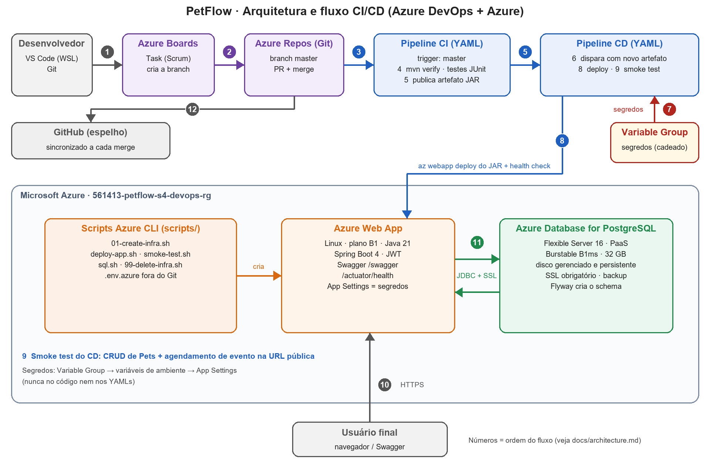

# Arquitetura e fluxo CI/CD

## Etapas numeradas (as mesmas do diagrama)

| # | Quem | O que acontece | Ferramenta |
|---|---|---|---|
| 1 | Desenvolvedor | Abre a Task e cria a branch a partir dela | Azure Boards |
| 2 | Desenvolvedor | Altera o código, faz push na branch da Task, abre a PR para `master` e conclui o merge | VS Code, Azure Repos |
| 3 | Azure Pipelines | O merge em `master` dispara o CI sozinho | `pipelines/ci.yml` |
| 4 | CI | `mvn clean verify`: compila e roda os testes JUnit (188; 190 depois da alteração da demo) | Maven, JUnit, JaCoCo |
| 5 | CI | Publica os resultados dos testes e o artefato `drop` (`petflow-api.jar`) | Pipeline Artifacts |
| 6 | Azure Pipelines | O artefato novo dispara o CD sozinho | `pipelines/cd.yml` |
| 7 | CD | Lê os segredos do Variable Group e grava os App Settings | Variable Group, Azure CLI |
| 8 | CD | `az webapp deploy` do JAR e espera do `/actuator/health` (app + PostgreSQL) | Azure CLI, Web App |
| 9 | CD | Smoke test: login, CRUD de Pets e agendamento de evento futuro na URL pública | `scripts/smoke-test.sh` |
| 10 | Usuário final | Usa o Swagger/API pela URL HTTPS do Web App | Azure Web App |
| 11 | Web App | Lê e grava no PostgreSQL (JDBC com SSL); o Flyway cria o schema na 1ª subida | Azure Database for PostgreSQL |
| 12 | Azure Pipelines | Em paralelo ao CI, o merge é espelhado no GitHub | `pipelines/mirror-github.yml` |

## Componentes

| Camada | Tecnologia |
|---|---|
| Aplicação | Java 21, Spring Boot 4, Spring Data JPA, Spring Security (JWT), Flyway, Swagger |
| Banco | Azure Database for PostgreSQL Flexible Server 16 (PaaS, Burstable B1ms, 32 GB, armazenamento persistente gerenciado) |
| Hospedagem | Azure App Service Linux B1, Java SE 21 |
| Infra | Azure CLI (`scripts/`), Resource Group `561413-petflow-s4-devops-rg` |
| CI/CD | Azure Boards, Repos, Pipelines (YAML) e Variable Group |
| Espelho | GitHub, atualizado automaticamente |

## Segredos

`DB_URL`, `DB_USERNAME`, `DB_PASSWORD`, `JWT_SECRET`, `GITHUB_PAT` e a senha do smoke test ficam no **Variable Group `petflow-s4-secrets`** (valores secretos, com cadeado). O CD os mapeia como variáveis de ambiente e grava nos App Settings do Web App. Nada disso vai para o código ou para os YAMLs. A Service Connection usa Workload Identity Federation (sem senha).

## Limitações assumidas

- O PostgreSQL aceita conexões de serviços Azure e do IP do desenvolvedor (regra `AllowClientIP`, só para os `SELECT` do vídeo). Sem VNet/Private Endpoint, por custo e simplicidade, e com SSL obrigatório. Depois da entrega, apague a regra `AllowClientIP` ou a infra inteira (`scripts/99-delete-infra.sh`).
- As regras de pontos e resgate (antes no package PL/SQL do Oracle) estão em Java (`RewardPointService`), com `SELECT ... FOR UPDATE`. Esta cópia da API usa PostgreSQL; o repositório da disciplina de Java continua em Oracle.
